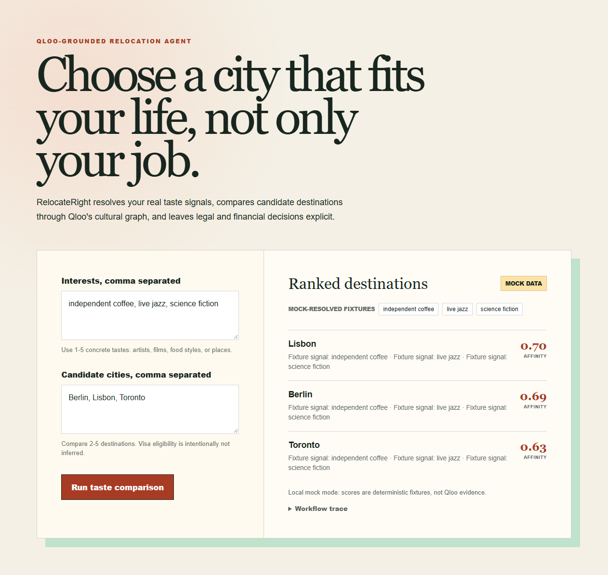

# RelocateRight

RelocateRight is an agentic relocation decision tool for remote-job candidates. It resolves a user's concrete taste signals, resolves candidate destinations, and asks Qloo's Insights API to rank those destinations against the same interest set in one bounded request. The same workflow is available through the web application and a Streamable HTTP MCP tool at `/mcp`.

This repository is currently a local pre-key scaffold. `QLOO_USE_MOCK=true` exists only for interface and workflow testing. Mock scores are labeled as fixtures in both the API response and UI and must not be used as Qloo evidence in a submission.



## Architecture

```text
Browser or MCP client
        |
        v
Next.js route boundary
        |
        v
Bounded relocation workflow
   |             |
   v             v
Qloo /search   Qloo /v2/insights
   |             |
   +-------> ranked shortlist + provenance trace
```

## Workflow

1. Validate and bound 1-5 interests and 2-5 candidate cities.
2. Resolve interests through `GET /search`.
3. Resolve candidates through `GET /search` with destination type filtering.
4. Rank only the resolved candidate IDs through one `GET /v2/insights` request using `filter.type=urn:entity:destination`, `filter.results.entities`, and `signal.interests.entities`.
5. Return the Qloo ordering, available affinity evidence, and an explicit workflow trace.

An agent client can call the bounded `rank_relocation_shortlist` MCP tool with the same 1-5 interest and 2-5 city limits. The tool explicitly excludes visas, employment eligibility, safety, salary, and cost of living from its result.

The agent does not infer visas, work authorization, salary, safety, or cost of living. Those are separate decision dimensions that need authoritative sources.

## Local development

```bash
npm install
Copy-Item .env.example .env.local
npm test
npm run typecheck
npm run dev
```

The browser is served at `http://localhost:3000` and the MCP endpoint at `http://localhost:3000/mcp`.

The example environment enables mock mode. When a hackathon key arrives:

```dotenv
QLOO_API_KEY=
QLOO_USE_MOCK=false
```

Set `QLOO_API_KEY` only in the server or hosting provider's secret store.

The key is sent only in the server-side `X-Api-Key` header to `https://hackathon.api.qloo.com`. It is never returned to the browser. Qloo response data must not be committed to the public repository.

## Status

- Deterministic mock workflow: implemented.
- Qloo API adapter: implemented against the official hackathon host and documented endpoints.
- Streamable HTTP MCP tool: implemented and covered by an in-process protocol test.
- Live-key contract verification: pending key issuance.
- Devpost registration: completed on October 11, 2026.
- Public MIT repository: https://github.com/sidsri14/qloo-relocate-right
- GitHub Actions: tests, strict typecheck, and production build pass on Node.js 22 and 24.
- Hosted live-Qloo demo and submission: not completed.

## License

MIT
